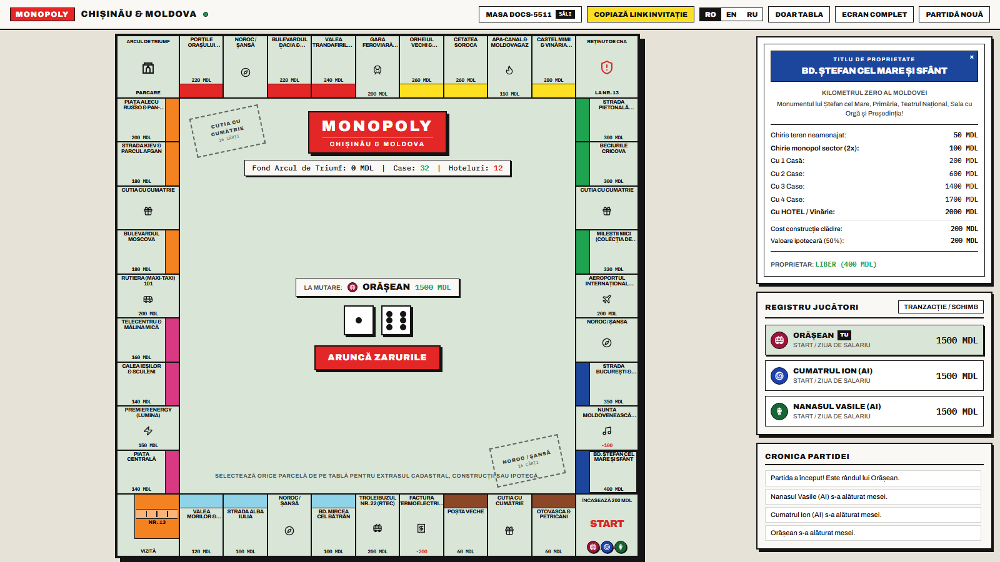
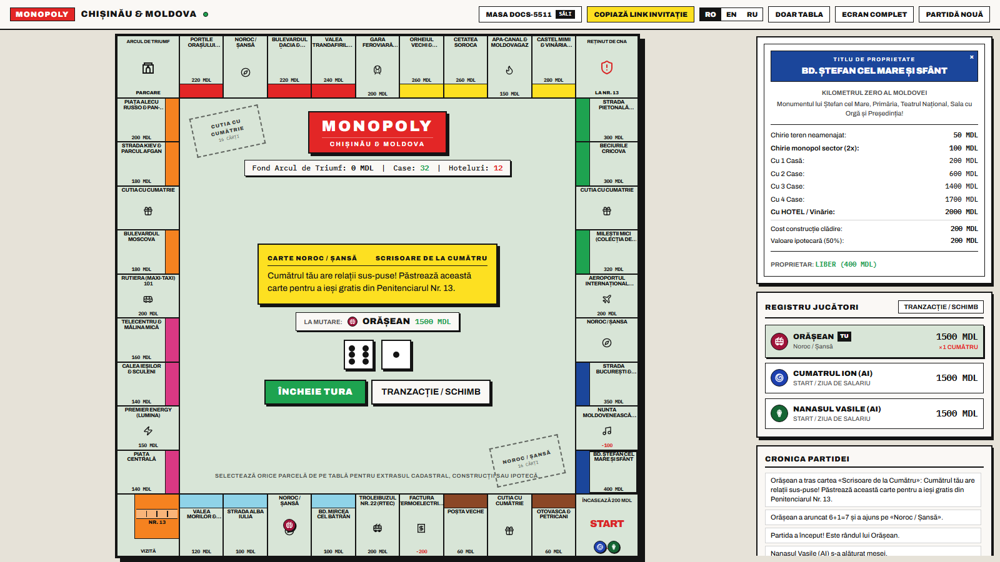
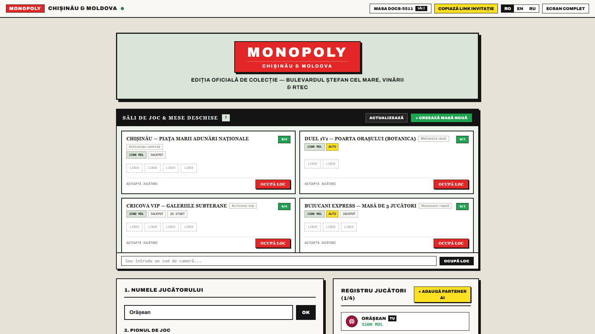
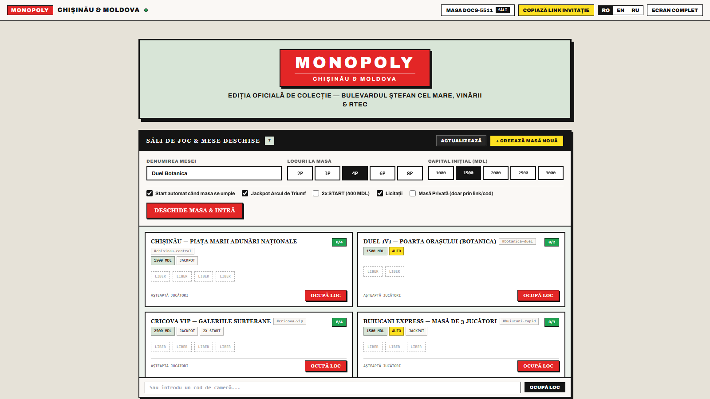
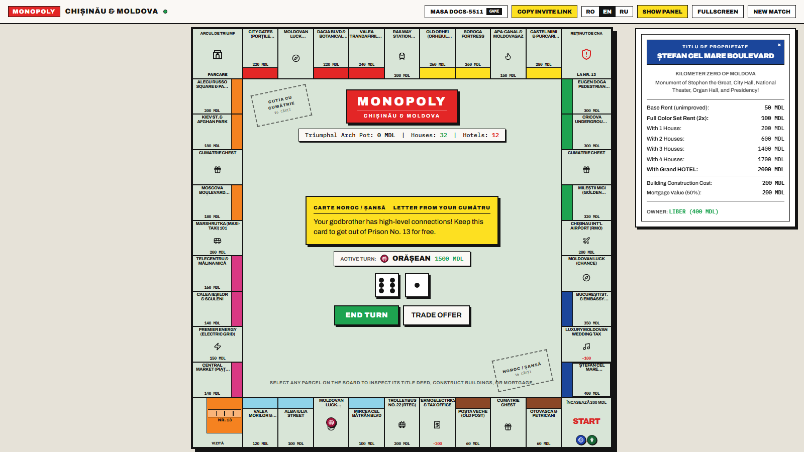

# MONOPOLY: Chișinău & Moldova Edition

A full-featured, real-time multiplayer **Monopoly** web game themed around **Chișinău and the Republic of Moldova**, built with a **Go (Golang)** WebSocket backend and a **React + TypeScript + Tailwind CSS** frontend.

---

## Screenshots

> Full walkthrough gallery: [docs/GALLERY.md](./docs/GALLERY.md)

### Full 40-Tile Board, Title Deed Inspector & Active Match


### Dice Roll & Drawing "Noroc / Șansă" (*Scrisoare de la Cumătru*)


### VK Monopoly-Style Open Tables Browser & Custom Table Builder
| Open Tables Directory | Custom Room Creator (`2P`–`8P`, `Auto-Start`) |
| :---: | :---: |
|  |  |

### Multi-Language (`RO` / `EN` / `RU`) & Board-Only Mode


---

## Features

### Complete Classic Monopoly Rules
- **40 Authentic Board Tiles**: Every street, sector, transport hub, winery, utility, and tax tile is mapped to iconic Chișinău & Moldova locations.
- **Doubles & Speeding**: Roll two dice; rolling doubles grants an extra turn, while 3 consecutive doubles send you straight to **Penitenciarul Nr. 13 (CNA Detention)**.
- **Penitenciarul Nr. 13 (Jail)**: Exit by rolling doubles (up to 3 turns), paying the **50 MDL** bail (*Cauțiune*), or using a **"Scrisoare de la Cumătru"** (*Get Out of Jail Free* card).
- **Full Color Set (Monopoly) & Even Building**:
  - Owning all unmortgaged properties in a color group doubles base rent (`2x`).
  - Build up to **4 Houses/Chioșcuri** and upgrade to a **Luxury Hotel/Vinărie** following strict **Even Building & Even Selling** rules.
  - Classic bank scarcity: **32 Houses** and **12 Hotels**.
- **Public Auctions**: Declining to buy an unowned property triggers a live **Public Auction** where all solvent players (and AI bots) can bid in real time.
- **Mortgaging & Unmortgaging**: Mortgage unimproved properties for **50%** of their purchase price and unmortgage for **55%** (50% + 10% interest).
- **Player-to-Player Trading**: Propose trades offering or requesting MDL cash and properties.
- **Debt Resolution & Bankruptcy**: Raise funds by selling buildings or mortgaging properties before paying debts, or declare bankruptcy (*Plecat în Diaspora*).

### VK Monopoly-Style Room Browser & Multiplayer
- **Unlimited Custom Rooms**: Create tables with `2`, `3`, `4`, `6`, or `8` seats, configurable starting cash (`1000`–`3000 MDL`), **Auto-Start when full**, and **Private Room** mode.
- **1-Click Invite Links**: Copy the room invite URL (`?room=<roomId>`) directly from the top bar to invite friends over LAN or the Internet.
- **Multi-Language Switcher (`RO` / `EN` / `RU`)**: Instant live switching between Romanian, English, and Russian for the entire board, UI, game log, and card decks.
- **8 Custom Vector Moldovan Tokens**:
  - **Troleibuzul 22** (*Trolleybus No. 22*)
  - **Plăcintă Învârtită** (*Traditional Moldovan Plăcintă*)
  - **Strugure de Moldova** (*Moldovan Grapes*)
  - **Pahar de Purcari** (*Glass of Purcari Wine*)
  - **Cușmă de Cârlan** (*Traditional Fur Hat*)
  - **Rutiera 101** (*Marshrutka No. 101*)
  - **Floarea-Soarelui** (*Moldovan Sunflower*)
  - **Vioara Lăutarului** (*Lăutar Violin*)

---

## Quick Start with Docker Compose (Recommended)

Run the entire stack (Go WebSocket server + React/Nginx client) with a single command:

```bash
docker compose up --build
```

- **Web Client (with Nginx `/api` & `/ws` reverse proxy)**: `http://localhost:5173`
- **Go Backend API & WebSocket Server**: `http://localhost:8080`

To run in detached background mode:

```bash
docker compose up -d --build
```

---

## Local Development (Without Docker)

### Prerequisites
- **Go** `1.24+`
- **Node.js** `20+` and **npm**

### 1. Start the Go Server
```bash
cd server
go run ./cmd/server
```
The server starts on `http://localhost:8080` (with WebSocket endpoint `ws://localhost:8080/ws` and REST endpoints `/api/rooms`, `/api/board`, `/api/health`).

### 2. Start the React + TypeScript Client
```bash
cd client
npm install
npm run dev
```
Open `http://localhost:5173` in your browser.

### Running Backend Unit Tests
```bash
cd server
go test -v ./...
```

