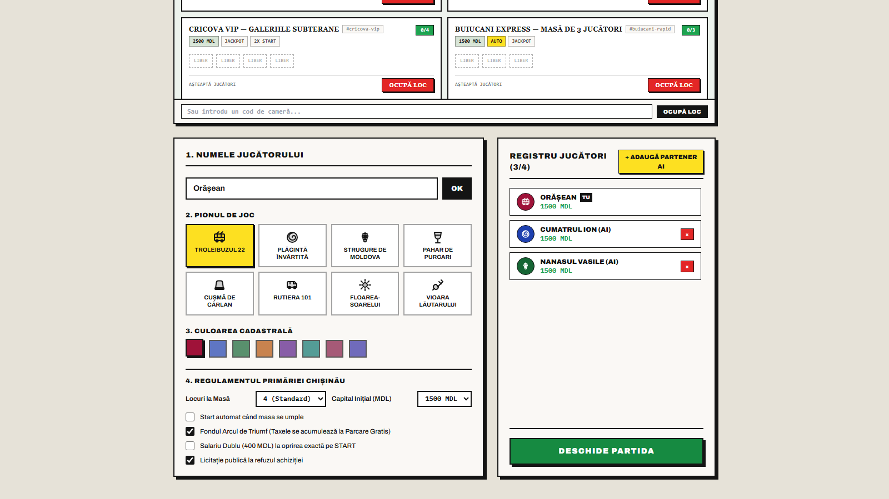

# Chișinău & Moldova Monopoly — Visual Walkthrough & Screenshot Gallery

All screenshots below were captured live from the running application (`Go` WebSocket server + `React + TypeScript + Tailwind CSS` client).

---

## 1. Lobby & VK-Style Open Tables Browser (`Săli de Joc & Mese Deschise`)
Players can browse all active public tables in real time, inspect seat occupancy (`[Pion] [ Liber ]`), see rule badges (`1500 MDL`, `AUTO`, `JACKPOT`, `2X START`), or join a private room by code.

---

## 2. Custom Table Creator (`+ Creează Masă Nouă`)
Anyone can spin up unlimited custom rooms with a custom table name, seat limit (`2P`, `3P`, `4P`, `6P`, `8P`), starting capital (`1000`–`3000 MDL`), **Auto-Start when full**, and **Private Room** mode.

---

## 3. Player Token Selector, Municipal Rules & AI Opponents
Choose from 8 custom vector Moldovan tokens (*Troleibuzul 22*, *Plăcintă Învârtită*, *Strugure de Moldova*, *Pahar de Purcari*, *Cușmă de Cârlan*, *Rutiera 101*, *Floarea-Soarelui*, *Vioara Lăutarului*), select your cadastre color, configure rules, and add AI opponents (*Cumătrul Ion*, *Nanașul Vasile*).

---

## 4. Full 40-Tile Printed Board & Title Deed Inspector
The full-viewport 11×11 board uses a physical Parker Brothers tabletop aesthetic (`#D8E5D7` celadon-mint surface, inward-facing property color bands on all 4 sides, crisp `#141414` ink borders, and white cardstock Title Deeds).

---

## 5. Rolling Dice & Drawing "Noroc / Șansă" Cards
After rolling `6 + 1 = 7` and hopping step-by-step onto **Noroc / Șansă**, the player draws *"Scrisoare de la Cumătru"* (*Get Out of Penitenciarul Nr. 13 Free*).

---

## 6. Live Multi-Language Switching (`RO` / `EN` / `RU`) & Board-Only Mode
Every tile, card, button, and log entry switches instantaneously between Romanian, English, and Russian. Toggling **Board Only** (`Doar Tabla`) hides the right sidebar so the board and Title Deed inspector take center stage.

